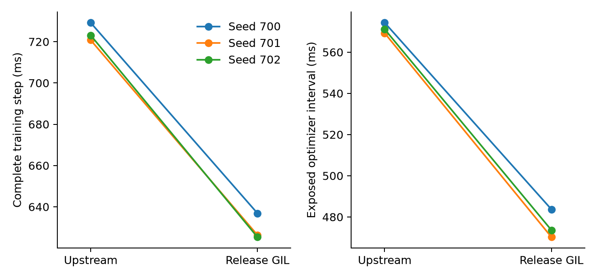

# CPUAdam execution outside the Python GIL

[Draft PR #9035](https://github.com/deepspeedai/DeepSpeed/pull/9035) contains the
native update and concurrent regression test. Submission commit
`790e42bec3823c24f134f9280641dd94f39e061c` targets master revision
`02f7978481cb3d3297f111c02b16d768b890b256` and includes the author's DCO sign-off.

[`cpu_adam_gil.patch`](cpu_adam_gil.patch) releases the Python GIL while
DeepSpeed's native CPU Adam kernel updates parameters. Independent CPU workers
can update concurrently, and the training thread can enqueue gradient downloads
and updated-weight uploads. The patch applies to public DeepSpeed revision
`1a956270f42fbe7ffa485fdff45499eb77318469`.

The optimizer registry lookup and step-state update retain the GIL. Each call
copies the small optimizer configuration before releasing it, because the CPU
`FusedAdam` implementation shares native configuration across parameter groups.
The kernel uses that call's configuration throughout its update. Parameters,
gradients and moment tensors retain their existing ownership and numerical
representation.

The patch changes the native update and adds a concurrent-update test for
`DeepSpeedCPUAdam` and CPU `FusedAdam`. The test runs two independent optimizers
with different learning rates and moments, and compares parameters and both
moment tensors against independent PyTorch AdamW instances over four steps.

## Validation

- The focused upstream suite passes 53 tests, including strict state updates,
  concurrent updates, rejection of unsupported AMSGrad and preservation of
  optimizer-state dtypes across checkpoint restoration.
- The upstream pre-commit checks pass for both changed files, including
  clang-format 18.1.3, Python formatting, lint and spelling checks.
- On Ascend, FP32/BF16 parameters, depths 1/3, three accumulated gradients,
  clipping and checkpoint resume pass four-step reference comparisons. Maximum
  FP32 weight error is `4.47e-8`.
- Actual DeepSpeed ZeRO-Offload passes four BF16 steps with three-way gradient
  accumulation; maximum weight error is `0.00048828125`.
- A complete pretrained Qwen3-0.6B model trains through the patched CPUAdam
  pipeline on held-out public document tokens.

Evidence is stored in `../results/cpu_adam_patch_tests.log`,
`../results/deepspeed_patch_precommit.log`,
`../results/npu_correctness_deepspeed_gil.json`,
`../results/zero_correctness_deepspeed_gil.json` and
`../results/qwen06_deepspeed_gil_functional.json`.

Submission validation against DeepSpeed `0.19.10+02f7978` is recorded in
[`../results/deepspeed_submission_20261108/`](../results/deepspeed_submission_20261108/).
It includes the 53 CPU tests, four Ascend dtype/depth cases, four ZeRO-Offload
updates, formatting output and the CI test-selection preview. The native CPU
Adam sources used by the paired performance measurements and submission
validation are identical apart from this patch.

## Reproduction

Run from the project root with its virtual environment and public DeepSpeed
checkout. The two performance extensions use identical CPU compiler flags;
the baseline sources come from the revision above. The installed DeepSpeed
package remains unchanged.

```bash
mkdir -p upstream
git clone https://github.com/deepspeedai/DeepSpeed.git upstream/DeepSpeed
git -C upstream/DeepSpeed checkout 1a956270f42fbe7ffa485fdff45499eb77318469
git -C upstream/DeepSpeed apply ../../contributions/cpu_adam_gil.patch
export TORCH_EXTENSIONS_DIR="$PWD/.torch_extensions"
DS_ACCELERATOR=cpu MAX_JOBS=1 OMP_NUM_THREADS=2 \
  .venv/bin/python build_cpu_adam_pair.py
DS_ACCELERATOR=cpu OMP_NUM_THREADS=2 \
  .venv/bin/python check_cpu_adam_patch.py
bash scripts/run_npu.sh 10 .venv/bin/python run_deepspeed_patch.py \
  validate_npu.py --cpu-optimizer deepspeed \
  --output results/npu_correctness_deepspeed_gil.json
bash scripts/run_npu.sh 10 .venv/bin/python run_deepspeed_patch.py \
  validate_zero.py --output results/zero_correctness_deepspeed_gil.json
.venv/bin/python run_cpu_adam_comparison.py --output results/cpu_adam_comparison
.venv/bin/python plot_cpu_adam_comparison.py results/cpu_adam_comparison/summary.json
```

The paired comparison uses three independent process pairs, seeds 700–702,
two warmup and six measured training steps, sequence length 256, two-way
gradient accumulation, 8 MiB buckets, depth four, eight OpenMP threads per worker
and affinity to 48 local physical cores. Baseline and patched order alternates
between pairs. The summary
retains complete-step timing, optimizer timing, memory and same-input loss and
gradient-norm differences.

## Complete training results

| Seed | Upstream step | GIL-release step | Speedup | NPU peak, both |
| --- | ---: | ---: | ---: | ---: |
| 700 | 729.22 ms | 636.85 ms | 1.145× | 3.764 GiB |
| 701 | 720.79 ms | 626.29 ms | 1.151× | 3.764 GiB |
| 702 | 723.13 ms | 625.30 ms | 1.156× | 3.764 GiB |

Each time is the median of six measured complete steps. The median paired
speedup is 1.151×. Peak CPU RSS is at most 8.577 GiB for either variant. All
paired gradient norms match exactly; the largest same-input loss difference
over all 24 warmup/measured step pairs is 4.77e-7.



[Raw steps and summary](../results/cpu_adam_comparison/) retain all six process
records. Model and optimizer construction and compilation precede step timing.

## Limitations

The contribution covers CPU Adam execution and its CPU fused caller. The
performance experiment uses one Ascend 910B2C and the local host's PCIe/NUMA
topology. It does not establish performance on CUDA, XPU or superchip links.
