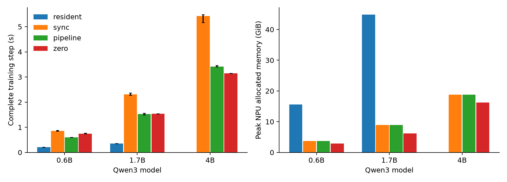
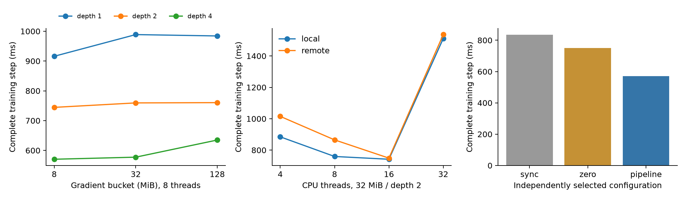
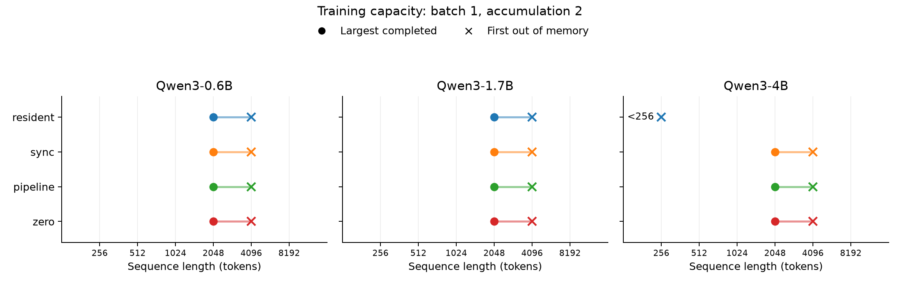
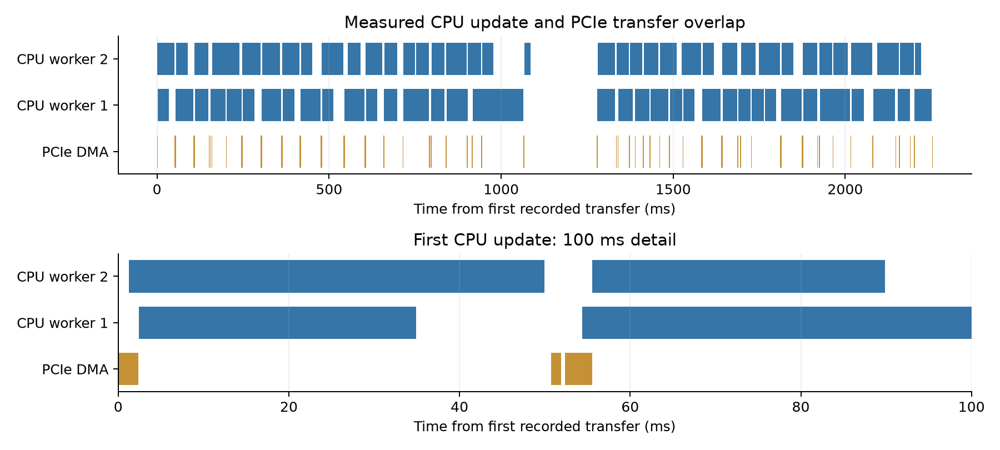
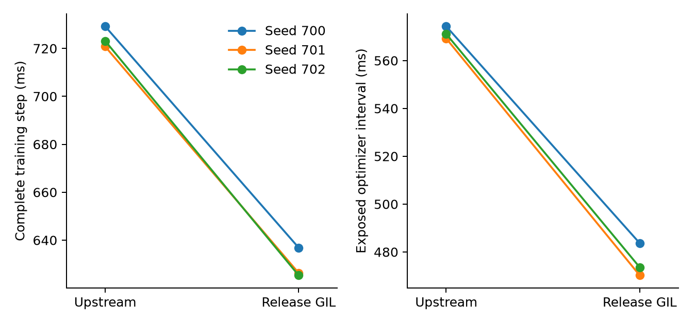

# NUMA-aware optimizer offload on Ascend 910B

A bounded CPU–NPU pipeline improves complete-step throughput over independently
tuned synchronous offload by **1.430×, 1.516× and 1.590×** on public Qwen3-0.6B,
1.7B and 4B. Against the actual DeepSpeed ZeRO-Offload engine, its advantage is
model dependent: **1.247× on 0.6B**, overlapping timings on 1.7B, and **8.52%
longer steps on 4B**. The pipeline uses more allocated NPU memory and CPU memory
than ZeRO on every model. Resident optimization is substantially faster when
its full state fits on the accelerator. Offloading completes 2,048-token
4B training where the tested resident optimizer fails at 256 tokens; all
three offload methods share that measured boundary.

The evidence comprises 33 independently initialized evaluation processes and
198 timed training updates on held-out public document tokens. A separate
three-pair experiment measures a 1.151× complete-training speedup from releasing
the GIL in DeepSpeed CPUAdam. Recorded device/CPU intervals demonstrate real
transfer/update overlap; the complete-step comparisons include both concurrent
CPU computation and transfer scheduling.

## Complete-training comparison

All rows use sequence length 256, microbatch one, two-way gradient accumulation,
two warmup updates and six timed updates. The table reports the median of three
process medians, with the minimum and maximum process medians in brackets.
Memory values are maxima across all warmup and measured steps; CPU RSS is the
process peak. The configurations selected on the separate calibration partition
remain fixed across all three models. Every recorded loss, gradient norm and
timed interval is finite.

| Model | Method | Complete step, ms | NPU allocated, GiB | NPU reserved, GiB | CPU RSS, GiB |
|---|---|---:|---:|---:|---:|
| Qwen3-0.6B | Resident | 212.36 [209.72, 212.94] | 15.553 | 21.193 | 4.037 |
| Qwen3-0.6B | Synchronous offload | 859.13 [848.14, 883.34] | 3.764 | 4.682 | 8.560 |
| Qwen3-0.6B | Pipelined offload | 600.76 [598.00, 602.35] | 3.764 | 4.682 | 8.558 |
| Qwen3-0.6B | ZeRO-Offload | 749.10 [740.63, 763.54] | 2.881 | 4.742 | 6.271 |
| Qwen3-1.7B | Resident | 353.48 [351.74, 354.45] | 44.877 | 60.090 | 8.223 |
| Qwen3-1.7B | Synchronous offload | 2313.04 [2274.45, 2368.69] | 8.914 | 10.654 | 21.126 |
| Qwen3-1.7B | Pipelined offload | 1526.01 [1490.54, 1562.82] | 8.914 | 10.654 | 21.140 |
| Qwen3-1.7B | ZeRO-Offload | 1535.73 [1533.28, 1537.73] | 6.185 | 11.213 | 14.644 |
| Qwen3-4B | Synchronous offload | 5429.11 [5169.43, 5485.82] | 18.788 | 21.832 | 46.856 |
| Qwen3-4B | Pipelined offload | 3414.99 [3398.27, 3461.30] | 18.788 | 21.832 | 46.871 |
| Qwen3-4B | ZeRO-Offload | 3146.87 [3144.26, 3147.81] | 16.258 | 24.398 | 31.795 |

On Qwen3-0.6B, the pipeline reduces step time from 859.13 to 600.76 ms versus
synchronous offload and from 749.10 to 600.76 ms versus ZeRO. Its allocated NPU
peak is 3.764 GiB, compared with 2.881 GiB for ZeRO. Resident optimization takes
212.36 ms but allocates 15.553 GiB.

On Qwen3-1.7B, the pipeline's 1,526.01 ms median is only 0.63% shorter than
ZeRO's 1,535.73 ms, and the repetition ranges overlap. It therefore has no clear
speed advantage over ZeRO in this experiment. Its allocated NPU and CPU RSS
peaks are 8.914 and 21.140 GiB, versus ZeRO's 6.185 and 14.644 GiB. Resident
optimization takes 353.48 ms with 44.877 GiB allocated NPU memory.

On Qwen3-4B, the pipeline remains faster than synchronous offload, but its
3,414.99 ms median is 8.52% longer than ZeRO's 3,146.87 ms. Their repetition
ranges do not overlap. ZeRO also uses less allocated NPU memory and CPU RSS:
16.258 and 31.795 GiB versus 18.788 and 46.871 GiB. The configuration selected on
0.6B does not establish an advantage over the engine baseline at larger scales.

The synchronous/pipelined comparison includes the jointly selected bucket,
thread and depth settings. Native optimizer intervals decrease from 712.71 to
453.94 ms on 0.6B, 2,126.45 to 1,338.66 ms on 1.7B, and 5,129.98 to 3,112.69 ms
on 4B. Both CPU-update concurrency and overlap with transfers contribute to the
execution schedule; these measurements do not isolate a DMA-only speedup.
ZeRO can move gradients during backward, so its post-backward optimizer
interval is not a like-for-like component comparison. Complete step time is
the primary cross-method metric.

The [raw summary](../results/evaluation_public/summary.json) records every seed,
configuration and process statistic; [CSV](../results/evaluation_public/summary.csv)
and [standalone PDF](../results/evaluation_public/training.pdf) reproduce the
comparison. Three-run ranges describe observed variability, not confidence
intervals.

## Execution model

The implementation trains all parameters of public Qwen3 models with BF16 model
weights and FP32 AdamW master weights and moments. It divides parameters into
fixed-capacity buckets, including splitting large tensors, and pipelines three
operations: copying accumulated gradients to pinned host memory, updating the
CPU master weights, and returning BF16 weights to the NPU.

All gradient accumulation completes before the optimizer computes the global
norm. One clipping coefficient applies to every bucket in the step. A CPU worker
waits for its download event before reading the staging buffer. A staging slot
becomes reusable only after its updated weights have reached the NPU, and the
optimizer waits for every upload before returning. These dependencies preserve
the current step's gradient and parameter semantics while allowing different
buckets to overlap. Depth controls both simultaneous CPU updates and transfer
overlap. Depth one provides the synchronous version of the same
implementation.

For a bucket containing at most B BF16 elements and depth d, pinned staging
storage is bounded by 4dB bytes: one BF16 download and one BF16 upload buffer per
slot. FP32 master weights and both moments occupy 12 bytes per parameter on the
CPU. Each active worker owns its FP32 gradient during the update. Gradients cross
PCIe in BF16, are converted and clipped on the CPU, and updated weights return in
BF16. Model weights and accumulated model gradients remain on the NPU.

`cpu_adam.cpp` implements a fused FP32 update with OpenMP and SIMD. Its native
function releases Python's GIL, allowing the host thread to continue scheduling
copies. `PipelinedAdamW` also supports PyTorch AdamW and DeepSpeed CPUAdam. The
separate DeepSpeed contribution releases the GIL around the existing native
Adam update and snapshots its small per-call optimizer configuration, including
the state shared by CPU `FusedAdam` parameter groups.

## Hardware and workload

Measurements use one 64 GiB Ascend 910B2C, physical card 10, attached to PCIe
device `0000:48:00.0` on NUMA node 0. The host has two Intel Xeon Platinum 8468
sockets, 48 physical cores per socket and 192 logical CPUs. PCIe sysfs reports
an active 32.0 GT/s, eight-lane link and a sixteen-lane device capability.
Local affinity uses
cores 0–47; remote affinity uses cores 48–95. Affinity is set before model and
optimizer allocation. Thread counts refer to the CPU update's OpenMP setting;
multiple workers can execute concurrently.

The runtime is Python 3.11.14, PyTorch 2.9.0, torch-npu
2.9.0.post1+gitdc51c2d, CANN 8.5.1, Transformers 4.57.6 and DeepSpeed 0.19.9.
[`environment.json`](../environment.json) records package versions, topology
and the public ModelScope file revisions for Qwen3-0.6B, 1.7B and 4B.

Calibration and evaluation inputs are contiguous spans from the public
[SQuAD 2.0 development documents](https://rajpurkar.github.io/SQuAD-explorer/dataset/dev-v2.0.json),
tokenized with the Qwen3 tokenizer. The first 16 articles, totaling 88,903
tokens, form the calibration partition. The remaining 19 articles, totaling
115,434 tokens, form the evaluation partition. A process samples its document
spans using a fixed seed, and all methods in a repetition use the same spans.

The resident baseline uses `NpuFusedAdamW` with FP32 master weights and moments
on the NPU. It also retains FP32 master-gradient buffers for the fused optimizer,
in addition to the BF16 model gradients. Weights, gradients, masters and moments
therefore require 20 bytes per parameter before activations and optimizer
workspace. Synchronous offload and the pipeline use the same fused CPU AdamW
kernel. The ZeRO baseline runs the actual DeepSpeed engine with stage 2, CPU
optimizer offload, pinned memory, contiguous gradients and `overlap_comm`.
Every method uses learning rate 1e-5, betas (0.9, 0.999), epsilon 1e-8, weight
decay 0.01 and global clipping at 1.0.

Whole-step timing begins after gradients are cleared and the device is
synchronized. It includes forward, accumulated backward, clipping, optimizer
execution, transfers and a final device synchronization. Model loading,
optimizer construction and extension compilation precede timing. Warmup steps are recorded separately.
The profiler is disabled for throughput measurements. Peak NPU allocated and
reserved memory and peak process resident CPU memory are recorded separately.
The optimizer interval begins after the final backward pass and measures
exposed post-backward work. ZeRO can transfer gradients during backward, so
this interval does not isolate the same operations across all methods; the
complete-step interval is the primary performance comparison.

## Independent calibration

The 28 calibration configurations use pretrained Qwen3-0.6B, sequence length
128, microbatch one, two-way accumulation, two warmup steps and five measured
steps. Bucket sizes are 8, 32 and 128 MiB; in-flight depths are 1, 2 and 4.
Local and remote affinity are compared at 4, 8, 16 and 32 CPU threads. The
synchronous and ZeRO baselines receive their own bucket/thread calibration.
Selection minimizes the median complete-step time.

| Selected method | Bucket | Depth | CPU threads | NUMA affinity | Calibration step |
| --- | ---: | ---: | ---: | --- | ---: |
| Synchronous offload | 32 MiB | 1 | 32 | Local | 834.34 ms |
| ZeRO-Offload | 32 MiB | Engine managed | 32 | Local | 750.78 ms |
| Pipelined offload | 8 MiB | 4 | 8 | Local | 570.44 ms |

Increasing the number of CPU threads does not monotonically improve training
time. At 32 MiB and depth two, 32 threads per worker are slower than 8–16
threads. Remote affinity adds visible cost at the smaller thread counts. With
eight local threads, increasing depth from one to four improves the measured
step time across all three bucket sizes: at 8 MiB, it decreases from 916.04 to
570.44 ms; at 128 MiB, from 984.22 to 634.94 ms. These observations motivate selecting
bucket size, depth and affinity together using complete training steps.

The selected configurations are stored in
[`selection.json`](../results/calibration_public/selection.json). The evaluation
entry point consumes that file without fitting on evaluation inputs. Main
comparisons use three independent processes per model and method, seeds
600–602, sequence length 256, two warmup steps and six measured steps. Each
process contributes its median step time; aggregate plots report the median and
range across processes. Method order rotates between repetitions.

## Measured capacity boundary

The fixed sequence grid is 256, 512, 1,024, 2,048, 4,096 and 8,192 tokens,
with microbatch one, two-way accumulation and unchanged precision/optimizer
semantics. Each method stops after its first explicit NPU out-of-memory result.
Eleven successful 256-token points reuse the main evaluation's seed-600 run
with two warmup and six measured steps. New capacity runs use seed 800, one
warmup update and three complete measured updates. The resident 4B configuration
starts with a new 256-token attempt.

| Model | Method | Largest completed sequence | First out-of-memory sequence |
|---|---|---:|---:|
| Qwen3-0.6B | Resident | 2048 | 4096 |
| Qwen3-0.6B | Synchronous offload | 2048 | 4096 |
| Qwen3-0.6B | Pipelined offload | 2048 | 4096 |
| Qwen3-0.6B | ZeRO-Offload | 2048 | 4096 |
| Qwen3-1.7B | Resident | 2048 | 4096 |
| Qwen3-1.7B | Synchronous offload | 2048 | 4096 |
| Qwen3-1.7B | Pipelined offload | 2048 | 4096 |
| Qwen3-1.7B | ZeRO-Offload | 2048 | 4096 |
| Qwen3-4B | Resident | None (<256) | 256 |
| Qwen3-4B | Synchronous offload | 2048 | 4096 |
| Qwen3-4B | Pipelined offload | 2048 | 4096 |
| Qwen3-4B | ZeRO-Offload | 2048 | 4096 |

All four methods reach 2,048 tokens on 0.6B and 1.7B and fail at 4,096 tokens.
Thus offload does not increase the longest completed length for these two
models on this grid. For 4B, the resident implementation fails at 256 tokens;
all three offload methods reach 2,048 and fail at 4,096. Offloading makes this
4B configuration trainable, while the pipeline has the same measured sequence
boundary as synchronous and ZeRO-Offload.

The experiment verifies all twelve model/method combinations, 33 new successful
capacity runs and 132 complete updates, plus the eleven reused main runs.
All successful records have finite losses, gradients and times; each first
OOM retains its log. The table gives observed grid boundaries, not exact
maximum lengths. No method reaches 8,192 before the stop condition. Capacity
runs establish completion and memory feasibility; their individual step times
are not used as the three-repeat performance comparison.

The resident result applies to `NpuFusedAdamW` with BF16 model weights/gradients,
FP32 master weights/gradients and FP32 moments, totaling 20 bytes per parameter
before activations and workspace. All models use eager attention. These
implementation choices define the measured boundary.

[Raw capacity records](../results/capacity_public/summary.json),
[CSV](../results/capacity_public/capacity.csv) and
[standalone PDF](../results/capacity_public/capacity.pdf) retain both endpoints.

## Measured overlap

A pretrained Qwen3-0.6B capture uses seeded synthetic 128-token inputs, 32 MiB
buckets, depth two, four threads per worker and local cores 0–7. It contains
72 CPU-update buckets and 1,380 PCIe DMA events over two measured steps.
The union of CPU update intervals is
1,944.02 ms; the union of DMA intervals is 156.82 ms. Their intersection is
81.09 ms, so 51.71% of recorded DMA time overlaps CPU updates. The CPU intervals
include gradient conversion, clipping, AdamW and conversion of returned weights.
The DMA measure includes the recorded PCIe transfers in the profiling window.
The two profiler step windows total 2,461.45 ms. PCIe DMA is active for
156.82 ms within those windows, or 6.37% of their duration. These windows include
profiler and step-bookkeeping overhead; throughput results use unprofiled
complete-step timers.

`analyze_pipeline.py` computes unions and intersections of actual event
intervals. The compact raw CPU and DMA records are preserved in
[`overlap_events.json`](../results/qwen06_pipeline_overlap/overlap_events.json),
and the standalone figure is reproducible with `plot_overlap.py`.

## DeepSpeed CPUAdam concurrency

The native CPUAdam GIL contribution improves complete Qwen3-0.6B training in
the four-worker bucket pipeline by a median paired **1.151×**, with a range of
1.145–1.156× across three independent pairs. Each process trains on held-out
public documents with sequence length 256, microbatch one, two-way accumulation,
8 MiB buckets, eight OpenMP threads per worker and local NUMA affinity.
Baseline and patched extensions use identical compiler flags. Variant order
alternates between pairs; each time is the median of six measured steps after
two warmup steps.

Peak NPU allocated memory is identical at 3.764 GiB. Peak process CPU RSS is at
most 8.577 GiB in either variant. All paired gradient norms match exactly and
the largest same-input loss difference is 4.77e-7 across 24 step pairs. The
contribution permits both concurrent native CPU updates and submission of
transfers by the training thread.

The [contribution and reproduction instructions](../contributions/README.md)
include per-seed timing and [raw records](../results/cpu_adam_comparison/).
This throughput experiment uses the bounded bucket pipeline; the separate
ZeRO engine test below establishes numerical compatibility.

## Numerical validation

Independent CPU-reference tests cover complete accumulated gradients, global
clipping, depths one and three, four consecutive updates, and checkpoint
resume for FP32 and BF16 model parameters. The fused CPU AdamW path has maximum
tested FP32 weight error 2.98e-8 and BF16 weight difference 0.00012207. The
resident fused NPU path has maximum tested weight error 2.38e-7.

Actual DeepSpeed ZeRO-Offload passes four BF16 update steps with three-way
accumulation; the largest reference weight difference is 0.00048828125. The
CPUAdam GIL contribution passes 51 focused upstream CPU tests and the same
Ascend accumulation, clipping and restore checks. Its maximum tested FP32
weight error is 4.47e-8. The tests compare public optimizer behavior with an
independent numerical reference, including parameters and both moments for
concurrent CPUAdam and CPU FusedAdam execution.

## Relation to prior systems

[ZeRO-Offload](https://www.deepspeed.ai/tutorials/zero-offload/) moves optimizer
state and computation to the CPU and uses an optimized CPU Adam implementation.
This study evaluates an actual ZeRO-Offload engine and separately measures a
bounded bucket pipeline on the same Ascend host.

[SuperOffload](https://supercomputing-system-ai-lab.github.io/projects/superoffload/)
targets tightly coupled superchips and combines speculative CPU updates with
validation, partial offloading and architecture-aware casting. This study
examines the PCIe/NUMA execution boundary on an Ascend host. Its update begins
after the complete accumulated global norm is known; the measured overlap is
between CPU updates and transfers for different buckets.

## Limitations

Results apply to this single host, its two-socket CPU/PCIe topology and one
Ascend 910B2C. The experiment uses dense pretrained Qwen3 models, eager
attention and BF16 forward/backward with FP32 AdamW state. Short training runs
establish executable updates and numerical agreement, not downstream task
convergence. Calibration uses Qwen3-0.6B and transfers one selected configuration
to the larger models. CPU affinity uses first-touch allocation rather than an
explicit NUMA memory policy. Capacity results refer to the tested
256/512/1024/2048/4096/8192-token grid at batch one and accumulation two. Success
at the largest grid point establishes a lower bound on capacity.
The resident capacity measurement applies to this fused optimizer implementation,
including its persistent FP32 gradient buffers.

The trace demonstrates actual overlap; its overlap fraction alone does not
measure a training speedup. CUDA, XPU, superchip links, multiple accelerators and
cross-node execution require separate measurements.
