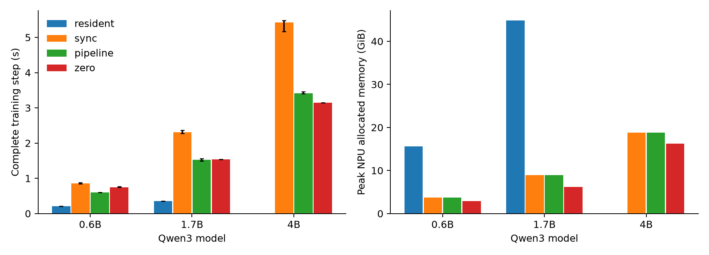
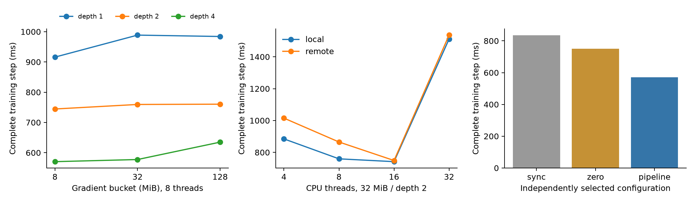
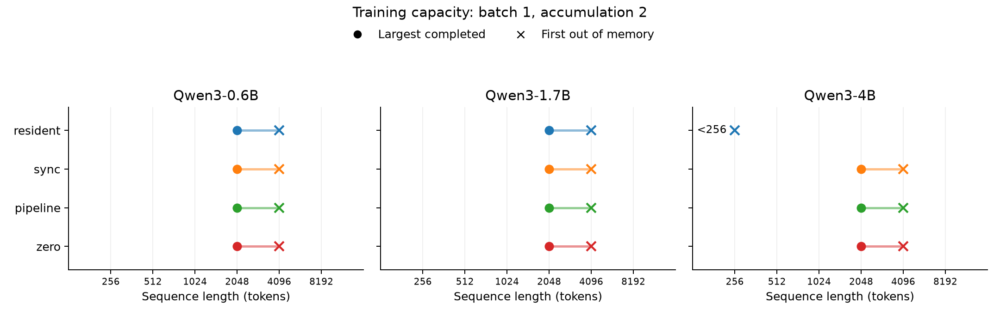
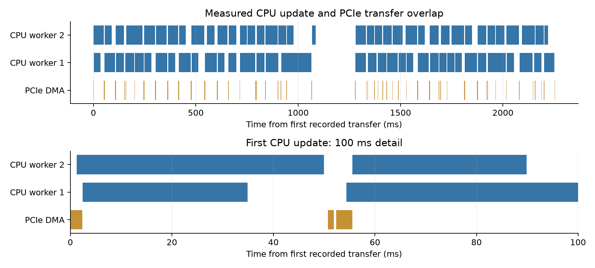
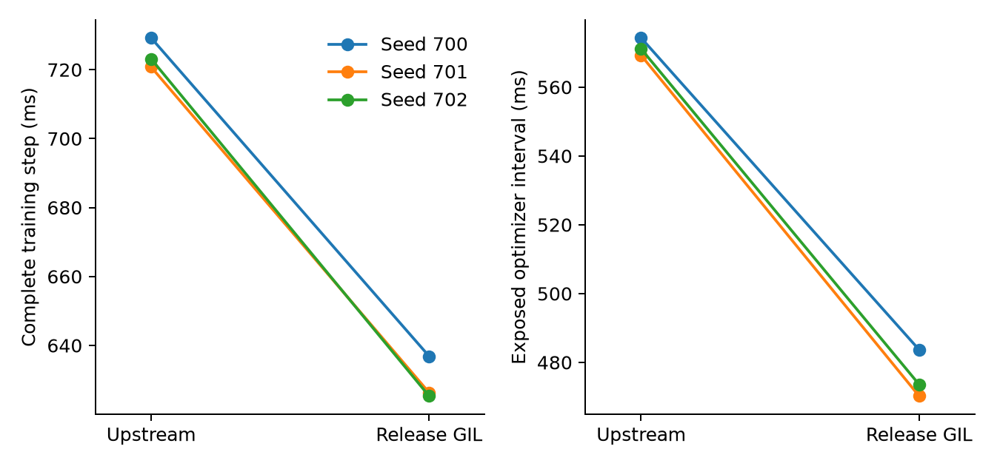

# Ascend 上的 NUMA 感知优化器卸载

这个项目研究的是完整训练步中的 CPU—NPU 配合：把 FP32 AdamW 主权重和
动量放到 CPU 后，怎样让梯度搬运、CPU 更新和权重回传有效重叠，以及
CPU 线程和 NUMA 位置怎样改变收益。

## 完整训练实测

在 Qwen3-0.6B、1.7B 和 4B 上，流水线相对独立调参后的同步卸载分别达到
**1.430×、1.516×、1.590×** 的完整 step 加速。相对真实 DeepSpeed
ZeRO-Offload，0.6B 有 **1.247×** 加速，1.7B 的三次重复范围重叠，4B 则
**慢 8.52%**。流水线在三个模型上的 NPU allocated 峰值和 CPU RSS 峰值
都高于 ZeRO。

最终比较包含 33 个独立进程、198 次计时更新。序列长度为 256，微批量为
1，梯度累计两次；每进程预热两步、计时六步。下表耗时取各进程六步中位数，
再取三个进程的中位数。完整范围和 NPU reserved 数值见英文报告与原始摘要。
显存峰值取预热和正式步骤中的最大值，CPU RSS 为进程峰值。

| 模型 | 方法 | 完整 step，ms | NPU allocated，GiB | CPU RSS，GiB |
|---|---|---:|---:|---:|
| Qwen3-0.6B | 全驻留 | 212.36 | 15.553 | 4.037 |
| Qwen3-0.6B | 同步卸载 | 859.13 | 3.764 | 8.560 |
| Qwen3-0.6B | 流水线卸载 | 600.76 | 3.764 | 8.558 |
| Qwen3-0.6B | ZeRO-Offload | 749.10 | 2.881 | 6.271 |
| Qwen3-1.7B | 全驻留 | 353.48 | 44.877 | 8.223 |
| Qwen3-1.7B | 同步卸载 | 2313.04 | 8.914 | 21.126 |
| Qwen3-1.7B | 流水线卸载 | 1526.01 | 8.914 | 21.140 |
| Qwen3-1.7B | ZeRO-Offload | 1535.73 | 6.185 | 14.644 |
| Qwen3-4B | 同步卸载 | 5429.11 | 18.788 | 46.856 |
| Qwen3-4B | 流水线卸载 | 3414.99 | 18.788 | 46.871 |
| Qwen3-4B | ZeRO-Offload | 3146.87 | 16.258 | 31.795 |

0.6B 的流水线耗时为 600.76 ms，低于同步卸载的 859.13 ms 和 ZeRO 的
749.10 ms，但 NPU allocated 为 3.764 GiB，高于 ZeRO 的 2.881 GiB。
1.7B 的流水线与 ZeRO 分别为 1,526.01 和 1,535.73 ms，约 0.63% 的中位
差距没有超出重复范围；4B 则为 3,414.99 和 3,146.87 ms，流水线的较慢
范围与 ZeRO 不重叠。全驻留在能够容纳状态的 0.6B、1.7B 上最快，但分别
分配 15.553 和 44.877 GiB 显存。

流水线相对同步卸载的收益同时包含 CPU 并行更新和传输重叠，也包含各自
校准选出的桶与线程配置。ZeRO 可以在反向过程中搬运
梯度，它的反向后 optimizer 区间与本实现包含的工作不同，跨系统比较以
完整 step 为准。

## 一步更新怎样执行

模型的 BF16 权重和累计梯度留在 NPU。所有梯度累计结束后，先计算完整
全局范数，再得到一个统一的裁剪系数。随后按桶执行：

1. 把该桶的 BF16 梯度复制到锁页 CPU 缓冲区。
2. CPU 工作线程等待复制完成，把梯度转成 FP32，乘以裁剪系数，更新
   FP32 主权重和两组动量。
3. 把更新后的权重转回 BF16，再复制到原 NPU 参数。

一个桶可以在 CPU 上计算，另一个桶同时搬运。缓冲区数量由流水线深度
限制；只有该槽位的权重回传完成，它才能服务下一个桶。整个优化器调用
返回前，所有权重都已回到 NPU，下一次前向使用本步完整更新后的参数。
深度为一时，同一实现就是同步卸载基线。

桶按元素容量划分，大矩阵可以跨桶。因此一个很大的 embedding 或线性层
不会强迫分配同样大的临时搬运缓冲区。每个槽位有一份 BF16 梯度缓冲区
和一份 BF16 权重缓冲区；CPU 主权重与动量则始终保留。

## 为什么联合选择桶、深度和线程

小桶能更早启动下一阶段，但会增加复制和调度次数；大桶减少调用次数，
但拉长首尾等待。增加在途桶可以覆盖更多等待，也会让多个 CPU 更新
竞争内存带宽。线程数还会乘上并发工作线程的数量，不能把单个 Adam
内核最快的线程配置直接当作训练流水线的最优配置。

本机有两颗 Xeon Platinum 8468，每颗 48 个物理核。实验的第 10 张
910B2C 连接 NUMA 节点 0；本地绑定使用核 0–47，远端绑定使用核 48–95。
亲和性在加载模型和分配状态前设置。PCIe sysfs 记录的实际链路为
32.0 GT/s、8 条 lane；设备声明的最大宽度为 16 条 lane。

28 组独立校准使用 Qwen3-0.6B、128-token 序列、两次梯度累计，覆盖
8/32/128 MiB 桶、1/2/4 深度和 4/8/16/32 CPU 线程。按完整训练步的
中位耗时，流水线选出本地 8 线程、8 MiB 桶、深度 4，校准耗时为
570.44 ms。同步卸载和实际 DeepSpeed ZeRO-Offload 分别独立调参后为
834.34 ms 和 750.78 ms。这些数值属于校准集；最终评价使用分开的文档、
更长输入和三个独立进程，不再根据评价结果选择参数。

## 实测容量边界

容量实验使用 256、512、1,024、2,048、4,096、8,192 token 的固定网格，
微批量为 1，梯度累计两次。每种方法遇到首次明确 OOM 后停止。11 个成功的
256-token 点复用主评价 seed 600 的两步预热、六步测量记录；其余容量点用
seed 800，一步预热后完成三次计时更新。4B 全驻留从 256 token 单独尝试。

| 模型 | 方法 | 最大完成长度 | 首次 OOM 长度 |
|---|---|---:|---:|
| 0.6B | 全驻留、同步卸载、流水线、ZeRO | 2048 | 4096 |
| 1.7B | 全驻留、同步卸载、流水线、ZeRO | 2048 | 4096 |
| 4B | 全驻留 | 无 | 256 |
| 4B | 同步卸载、流水线、ZeRO | 2048 | 4096 |

卸载让这个全驻留实现容不下的 4B 配置可以训练，但三种卸载方法的容量边界
相同。较小两个模型在本次网格中也没有获得更长的成功序列。已测成功点为
2,048，首个 OOM 点为 4,096；尚未细分两者之间的长度。

12 个模型/方法组合全部完成容量核对，33 个新增成功进程完成了 132 次更新，
损失、梯度和时间均为有限值；每组首次 OOM 日志保留。容量实验记录可执行性，
性能表采用独立三重复主实验。这里的全驻留边界对应每参数 20 字节状态及
额外工作区的 NpuFusedAdamW 实现，所有模型均使用 eager attention。
完整端点见 [容量 CSV](../results/capacity_public/capacity.csv)。

## 用真实时间线确认重叠

Profiler 使用预训练 Qwen3-0.6B、固定种子的合成 128-token 输入、
32 MiB 桶、深度 2、每个工作线程启用 4 个 OpenMP 线程，并绑定本地核 0–7。
两步记录含 72 个 CPU 更新桶和 1,380 个 PCIe
DMA 事件。CPU 更新区间并集为 1,944.02 ms，DMA 区间并集为 156.82 ms，
交集为 81.09 ms，即 51.71% 的 DMA 时间与 CPU 更新重叠。这里按区间
并集计算，多个工作线程同时更新时不会重复累计相同的墙钟时间。
两个 profiler step 区间合计 2,461.45 ms，其中 PCIe DMA 活跃 156.82 ms，
占 6.37%。这些区间包含 profiler 和逐步记录开销；正式吞吐结果使用关闭
profiler 后的完整 step 计时。

CPU 原生更新需要释放 Python GIL，否则工作线程计算 Adam 时，主线程
也可能无法继续提交搬运。独立 DeepSpeed 补丁在其原生 CPU Adam 调用
期间释放 GIL，并保留本次调用独立的优化器配置。CPU FusedAdam 的共享
配置也由此得到正确处理。补丁的 51 项上游 CPU 测试和实际 Ascend、ZeRO
更新检查均已通过。

使用相同编译选项、输入和流水线配置，三组独立 Qwen3-0.6B 完整训练
配对的加速比中位数为 **1.151×**，范围 1.145–1.156×。配置为序列长
256、微批量 1、两次梯度累计、8 MiB 桶、深度 4，每个工作线程使用
8 个 OpenMP 线程，并绑定 48 个本地物理核。每个独立进程预热两步，
再取六步完整耗时的中位数；每组交替运行两个版本。

两种版本的 NPU allocated 峰值均为 3.764 GiB，CPU RSS 峰值均不超过
8.577 GiB。全部配对梯度范数一致，24 对训练步骤的损失最大差异为
4.77e-7。这里测量的是桶流水线中的 CPUAdam 并发执行；独立 ZeRO
engine 测试验证更新正确性。

## 正确性与测量口径

数值验证覆盖 FP32/BF16、三次梯度累计、全局裁剪、不同流水线深度和
断点恢复，并使用独立 CPU 参考比较连续四步。原生融合 CPU AdamW 的
FP32 最大权重误差为 2.98e-8；实际 ZeRO-Offload 的 BF16 最大权重差为
0.00048828125。

完整训练步计时包括前向、反向、裁剪、AdamW、搬运和最终同步。所有
方法保留相同的 BF16 模型与 FP32 AdamW 主权重、动量语义。全驻留
基线使用 NpuFusedAdamW，ZeRO 基线运行真实 DeepSpeed stage 2 引擎。
全驻留融合优化器在 BF16 模型梯度之外保留 FP32 主权重梯度缓冲区；
权重、梯度、主权重和动量合计每参数 20 字节，另需激活与优化器工作区。
峰值 NPU 分配量、NPU 保留量和进程 CPU 驻留量分别记录。
模型加载、优化器构造和扩展编译在计时前完成，预热步骤单独记录。

校准文档与评价文档来自公开 SQuAD 2.0 开发集的不相交文章。前 16 篇
用于校准，后 19 篇用于评价；同一轮各方法采用同样的随机种子和文档
片段。公开模型的文件版本、软件环境和复现命令保存在
[`environment.json`](../environment.json) 与 [`README.md`](../README.md)。

## 适用边界

结论限定于本机 CPU/PCIe/NUMA 拓扑及单张 910B2C。短训练验证更新语义
与执行成本，不能替代下游任务收敛实验。模型使用 eager attention，
校准配置从 0.6B 迁移到更大模型。NUMA 控制采用 CPU 亲和性和首次写入
分配，没有强制内存绑定。

显存容量实验报告固定 256–8192-token 网格中的已测成功点与首次 OOM 点。
时间线中的重叠比例描述 DMA 与 CPU 更新的同时执行区间；训练加速比来自
独立的完整 step 测量。全驻留容量对应上述融合优化器及其 FP32 梯度存储。
多卡、跨节点以及其他加速器需要独立测量。
